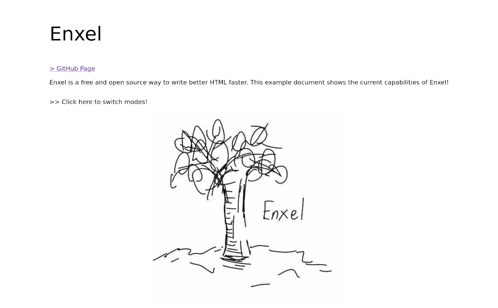
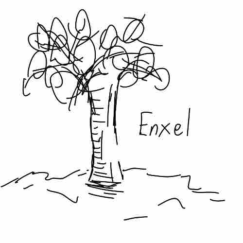

```xml
<hcon align-items='center'>
	<vcon>
		<text size='50'>Enxel</text>
		<link to='https://github.com/artelephantb/enxel'>> GitHub Page</link>
		<text>Enxel is a free and open source way to write better HTML faster. This example document shows the current capabilities of Enxel!</text>
		<hcon align-items='center'>
			</img>
		</hcon>
	</vcon>
</hcon>
```

# Types
- **Script Connection** (connect)
- **Text** (text)
- **Link** (link)
- **Image** (img)
- **Vertical Container** (vcon)
- **Horizontal Container** (hcon)
